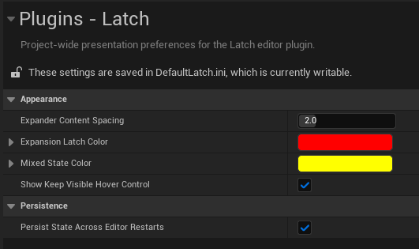

# Latch

**Persistent World Outliner Hierarchy Controls for Unreal Engine**

**Keep your Outliner organized. Even when your workflow needs something inside a collapsed branch.**

Latch keeps the hierarchy you arranged in Unreal Engine's **World Outliner** under your control. Latch folders and Actors open or closed, reveal only the paths to important descendants, and pin frequently used items—without restructuring your level or replacing Unreal's native Outliner.

    

  

---

## Your hierarchy should stay organized

A large Unreal level is easier to work in when finished areas are collapsed, the current work area is expanded, and important Actors are easy to find. But selection, search and recursive expansion can disturb that carefully arranged tree.

Sometimes you need a collapsed parent to **stay collapsed** while an Actor deep inside it remains accessible. Normally, reaching that Actor means expanding the branch and bringing back all its siblings.

**Latch gives you control over both.**

- **Preserve your arrangement.** Keep eligible folders and Actor parents latched open or closed, even during ordinary expansion operations.
- **Find what matters without the clutter.** Reveal only the ancestor path needed for a selected, pinned or latched-open descendant.
- **Keep important items close.** Pin Actors and Folders you want to remain accessible through collapsed branches.
- **Use the Outliner you already know.** Work with familiar triangles, modifiers and context menus—not a separate window.
- **Keep editing preferences separate from level content.** Save your hierarchy arrangement across sessions without storing it in your Actor or level packages.

  

## Explore the documentation

> ### [**Latch Documentation — Full User Guide and Technical Reference**](https://mippi-the-dork.github.io/Latch/)
>
> **Everything you need to learn and use Latch, in one place.** Find step-by-step interaction guides, understand the red, yellow and white indicators, configure persistence, troubleshoot hierarchy behavior, or explore how Latch integrates with the Unreal Editor.
>
> **[Get Started](https://mippi-the-dork.github.io/Latch/?page=01-getting-started%2FREADME.md)** · **[Hierarchy Controls](https://mippi-the-dork.github.io/Latch/?page=02-hierarchy-controls%2FREADME.md)** · **[Interactions & Workflows](https://mippi-the-dork.github.io/Latch/?page=03-interactions-and-workflows%2FREADME.md)** · **[Settings & Persistence](https://mippi-the-dork.github.io/Latch/?page=04-settings-and-persistence%2FREADME.md)**

The README introduces what Latch offers. **The [documentation website](https://mippi-the-dork.github.io/Latch/) is the maintained reference for exact interactions, installation, expected behavior and technical details.**

## Three visual states. One predictable hierarchy.

Latch builds on native World Outliner expansion rather than creating a competing hierarchy. Its visual language helps you distinguish **your saved intent** from **temporary paths the editor needs to show**.

| Hierarchy control | What it does |
| --- | --- |
| **[Expansion Latches — Red](https://mippi-the-dork.github.io/Latch/?page=02-hierarchy-controls%2Fexpansion%2FDESIGN.md)** | Hold an eligible parent expanded or collapsed, protecting its intended state from ordinary and recursive expansion changes. |
| **[Mixed View — Yellow](https://mippi-the-dork.github.io/Latch/?page=02-hierarchy-controls%2Fmixed-view%2FDESIGN.md)** | Temporarily expose the minimum ancestor path to a required descendant without fully opening unrelated siblings or replacing the logical collapse. |
| **[Keep Visible — White](https://mippi-the-dork.github.io/Latch/?page=02-hierarchy-controls%2Fkeep-visible%2FDESIGN.md)** | Pin an Actor or Folder so Latch can keep its Outliner row reachable through collapsed ancestors. |

**Red is a stored expansion choice. Yellow is a temporary presentation state. White marks a pinned item.** They work together without changing which Actors belong to which folders or attachment hierarchies.

## Useful in real production workflows

### Keep finished areas closed and active work open

Expand your active folder and **Alt-click** its triangle to latch it open. Collapse a finished folder and Alt-click to latch it closed. Red expansion indicators show which parents are protected.

Use **Shift-click** for recursive expansion of unlocked branches while respecting the existing red latches. You can also apply compatible actions across selected rows.

[**Learn about expansion, recursive changes and multi-selection →**](https://mippi-the-dork.github.io/Latch/?page=02-hierarchy-controls%2Frecursive%2FDESIGN.md)

### Reach deeply nested Actors without expanding everything

Select an Actor in the viewport or pin one deep inside a collapsed hierarchy. Latch can show only the path to that item, turning the necessary logically collapsed ancestor indicators **yellow**. Unrelated sibling rows remain out of the way.

Click a yellow triangle when you want to commit a normal expanded view of that branch.

  

[**Explore Mixed View and Keep Visible →**](https://mippi-the-dork.github.io/Latch/?page=02-hierarchy-controls%2Fmixed-view%2FDESIGN.md)

### Keep your arrangement while you search or switch tasks

World Outliner search temporarily takes control of what is shown. Clear the search, and Latch restores your logical expansion choices and recalculates any needed Mixed View paths.

Need ordinary Unreal expansion for a while? **Suspend Latch** without discarding your stored red latches and white pins, then resume when you're ready.

[**Search behavior](https://mippi-the-dork.github.io/Latch/?page=03-interactions-and-workflows%2Fsearch%2FDESIGN.md)** · **[Suspend and Resume](https://mippi-the-dork.github.io/Latch/?page=03-interactions-and-workflows%2Fsuspend%2FDESIGN.md)**

### Keep your workspace yours

Latch can preserve expansion latches, Keep Visible pins and the suspended state between editor sessions using **per-project editor configuration**, not your level or External Actor packages.

Disable persistence when an arrangement is only useful for the current session. Adjust spacing, semantic colors and pin hover behavior through **Project Settings → Plugins → Latch**.

  

[**Learn how Latch persistence and saved state work →**](https://mippi-the-dork.github.io/Latch/?page=04-settings-and-persistence%2Fpersistence%2FDESIGN.md)

## Get Latch

**Latch v2.0.3** targets **Unreal Engine 5.8.x on Windows 64-bit** and runs in the **Editor only**.

For most users, install through Fab or use a compatible prebuilt release. Developers can also build the complete source from this repository.

**[Get Latch on Fab](https://www.fab.com/listings/280bc637-782a-45a3-a949-9423e745bf34)** · **[Download GitHub Releases](https://github.com/mippi-the-dork/Latch/releases)** · **[Installation Guide](https://mippi-the-dork.github.io/Latch/?page=01-getting-started%2Finstall%2FDESIGN.md)** · **[First Five Minutes](https://mippi-the-dork.github.io/Latch/?page=01-getting-started%2Ffirst-use%2FDESIGN.md)**

## Important limitations

Latch is a **World Outliner presentation utility**, not a replacement hierarchy system, an Actor-visibility tool or a runtime gameplay feature.

- **Editor-only.** Latch does not run in packaged games or maintain persistent Outliner state for PIE/runtime-spawned Actors.
- **Expansion latches require children.** A childless row has no expandable branch to latch. If a parent loses its final child, its previous latch may be cleared rather than automatically restored when a child returns.
- **Keep Visible affects Outliner rows, not rendering.** Pins do not change viewport visibility, Hidden in Game, or gameplay visibility. Root-level pins have no collapsed ancestor path to reveal.
- **Search temporarily controls the tree.** Unreal's search presentation may override the visible arrangement until the search is cleared.
- **Stored state is per-project editor configuration.** Latch preferences are not serialized into Actor/level packages and need not be shared among team members.
- **The actual scene hierarchy is unchanged.** Latch does not rename, reorder, move, transform, attach, detach or reparent Actors, change Folder membership, or replace the native World Outliner.

For details, see [Troubleshooting and FAQ](https://mippi-the-dork.github.io/Latch/?page=05-implementation-and-support%2Ftroubleshooting%2FDESIGN.md) and [Identity and Parent Lifecycle](https://mippi-the-dork.github.io/Latch/?page=04-settings-and-persistence%2Fidentity%2FDESIGN.md).

## What's next?

Latch v2.0.3 already provides the core expansion latch, Mixed View, Keep Visible, search-aware and persistence workflows. Future review areas include Unreal Editor compatibility, hierarchy usability, performance in very large Outliners, and additional testing.

**No new release scope or dates are committed.** These are directions for evaluating Latch's future, not features included in the current version.

[**View the Latch Roadmap →**](https://mippi-the-dork.github.io/Latch/?page=ROADMAP.md)

## Issues, feature requests and contributions

Found a bug? Please [open an issue](https://github.com/mippi-the-dork/Latch/issues) with your Latch/Unreal versions, installation method, Actor or Folder type, current red/yellow/white state, selection and search conditions, reproduction steps, and screenshots or an Unreal Output Log excerpt where helpful.

Have an idea? [Submit a feature request](https://github.com/mippi-the-dork/Latch/issues) describing the hierarchy workflow problem and what you'd like to accomplish, rather than only a specific implementation.

**Pull requests are welcome.** For major changes, open an issue first to discuss the intended scope and design. Latch aims to remain compact, predictable and native to Unreal's World Outliner.

## License

Latch is distributed under the **MIT License**. See [LICENSE](LICENSE) for the full terms.

---

**Latch is created by Mippi the Dork.**

**[Explore the Documentation](https://mippi-the-dork.github.io/Latch/)** · **[Get Latch](https://github.com/mippi-the-dork/Latch/releases)** · **[Report an Issue](https://github.com/mippi-the-dork/Latch/issues)**
