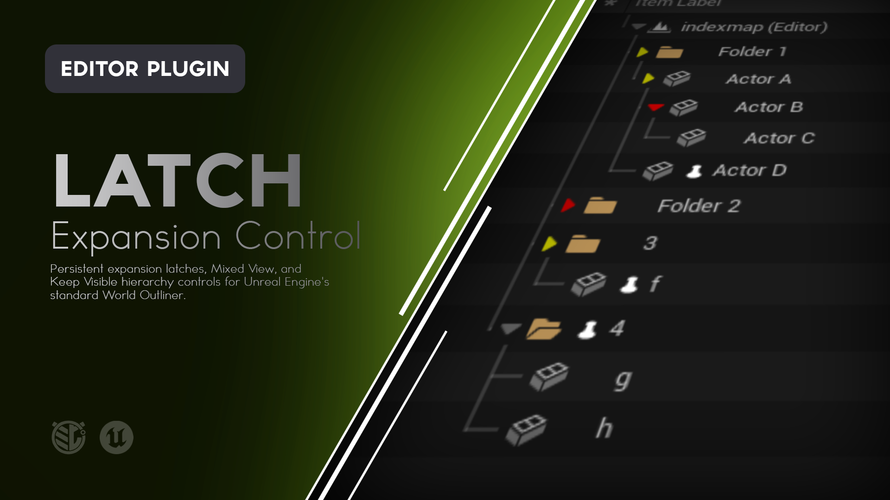
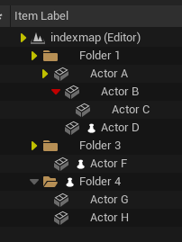
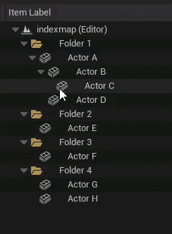

# Latch

**Keep your World Outliner organized—even when Unreal has other plans.**

Latch is a lightweight, editor-only Unreal Engine plugin that gives you control over which hierarchy branches stay expanded, which stay collapsed, and which important items remain easy to find. It works directly inside Unreal's native **World Outliner**, without replacing your hierarchy or changing your level.

**[Explore the Latch Documentation](https://mippi-the-dork.github.io/Latch/)** · **[Get Latch on Fab](https://www.fab.com/listings/280bc637-782a-45a3-a949-9423e745bf34)** · **[GitHub Releases](https://github.com/mippi-the-dork/Latch/releases)**

---

## The problem: your hierarchy won't stay the way you left it

Anyone working in a large Unreal level knows the routine: you've carefully collapsed finished areas, expanded the section you're working on, and arranged the World Outliner so the important things are easy to reach.

Then you select an Actor, search for something, or navigate a deeply nested folder—and suddenly you're digging through the hierarchy again.

The underlying problem is simple: **the Outliner has one tree, but you often need two things at once**. You want a parent to remain collapsed *and* a particular descendant to remain accessible.

**Latch lets you do both.** It remembers your expansion choices and reveals only the hierarchy paths you actually need, without reorganizing a single Actor.

## What Latch brings to the Outliner

### Lock a branch open. Or keep it closed.

**Expansion Latches** let you protect the current expanded or collapsed state of an eligible Actor or Folder. A **red triangle** shows that a parent is latched. Ordinary expansion clicks and recursive operations respect that choice until you remove the latch.

A finished environment section can stay neatly closed while your active work area stays open.

**[See Expansion Latches in action](https://mippi-the-dork.github.io/Latch/?page=02-hierarchy-controls%2Fexpansion%2FDESIGN.md)**

### Keep important items accessible without opening everything

**Mixed View** solves the awkward case where a deeply nested Actor needs to be accessible inside a collapsed branch. Latch exposes only the required path and uses **yellow triangles** to show ancestors that are logically collapsed but temporarily presenting a descendant.

Unrelated sibling branches can stay out of your way. A yellow path is temporary presentation—not a new saved expansion mode.

**[Understand Mixed View](https://mippi-the-dork.github.io/Latch/?page=02-hierarchy-controls%2Fmixed-view%2FDESIGN.md)**

### Pin the Actors and Folders you keep coming back to

**Keep Visible** puts a small pin beside eligible Actor and Folder labels. Turn it on and the pin becomes **white**; Latch can keep that item reachable even when its ancestors are collapsed. The pin follows the item's identity when it moves or is renamed, where stable identity is available.

This is **Outliner visibility**, not viewport visibility. It doesn't turn an Actor's rendering on or off.

**[Explore Keep Visible](https://mippi-the-dork.github.io/Latch/?page=02-hierarchy-controls%2Fkeep-visible%2FDESIGN.md)**

### Fits the way you already work

Latch builds on Unreal's existing World Outliner instead of introducing another window or a separate hierarchy.

- **Familiar input:** normal clicking still handles unlocked expansion; Alt-click latches a parent, and Shift-click handles recursive expansion while respecting existing latches.
- **Multiple items at once:** apply expansion latches or Keep Visible pins across eligible selected rows.
- **Right-click access:** reach Latch commands through the World Outliner and selected-Actor viewport context menus.
- **Search-aware behavior:** search temporarily controls the visible tree; when you clear the query, Latch restores your logical arrangement.
- **Suspend and resume:** return temporarily to native Outliner expansion without deleting your recorded latch and pin choices.

**[Multi-selection](https://mippi-the-dork.github.io/Latch/?page=02-hierarchy-controls%2Fmulti-selection%2FDESIGN.md)** · **[Context menus](https://mippi-the-dork.github.io/Latch/?page=03-interactions-and-workflows%2Fcontext-menu%2FDESIGN.md)** · **[Search behavior](https://mippi-the-dork.github.io/Latch/?page=03-interactions-and-workflows%2Fsearch%2FDESIGN.md)** · **[Suspend / Resume](https://mippi-the-dork.github.io/Latch/?page=03-interactions-and-workflows%2Fsuspend%2FDESIGN.md)**

### Your preferred layout can survive an editor restart

Latch can preserve expansion latches, Keep Visible pins, and suspension state across level reloads and editor sessions. That information is stored in **per-project editor configuration**, not inside your level or Actor packages.

That means organizing the Outliner with Latch doesn't itself require saving the level or checking out External Actor files. You can also disable persistence when you only want an arrangement for the current session.

Adjust expansion spacing, latch and Mixed View colors, Keep Visible hover behavior, and persistence in **Project Settings → Plugins → Latch**.

**[How persistence works](https://mippi-the-dork.github.io/Latch/?page=04-settings-and-persistence%2Fpersistence%2FDESIGN.md)** · **[Project Settings reference](https://mippi-the-dork.github.io/Latch/?page=04-settings-and-persistence%2Fsettings%2FDESIGN.md)**

---

## Imagine your next large level

You have a finished section with hundreds of Actors, an active area you're editing, and a few gameplay Actors scattered deep inside the hierarchy.

With Latch, you can keep the finished section **latched closed**, the active folder **latched open**, and the important gameplay Actors **pinned**. When you need one of those pinned Actors, Latch can reveal just its path—not every sibling under every collapsed ancestor.

**Less hunting through folders. More time working in the level.**

---

## Documentation

### Everything you need, in one place

The README is an introduction to Latch. The dedicated documentation site contains the full usage instructions, feature behavior, examples, technical details, limitations, troubleshooting, and future roadmap.

**[Open the complete Latch Documentation](https://mippi-the-dork.github.io/Latch/)**

| Looking for… | Start here |
| --- | --- |
| Installing Latch | [Installation and compatibility](https://mippi-the-dork.github.io/Latch/?page=01-getting-started%2Finstall%2FDESIGN.md) |
| Trying it for the first time | [First Use](https://mippi-the-dork.github.io/Latch/?page=01-getting-started%2Ffirst-use%2FDESIGN.md) |
| Understanding red, yellow and white indicators | [Hierarchy Controls](https://mippi-the-dork.github.io/Latch/?page=02-hierarchy-controls%2FREADME.md) |
| Working across multiple selected items | [Multi-Selection](https://mippi-the-dork.github.io/Latch/?page=02-hierarchy-controls%2Fmulti-selection%2FDESIGN.md) |
| Using search without losing expansion choices | [Search-Aware Presentation](https://mippi-the-dork.github.io/Latch/?page=03-interactions-and-workflows%2Fsearch%2FDESIGN.md) |
| Saving and restoring your layout | [Workspace Persistence](https://mippi-the-dork.github.io/Latch/?page=04-settings-and-persistence%2Fpersistence%2FDESIGN.md) |
| Troubleshooting unexpected behavior | [Troubleshooting and FAQ](https://mippi-the-dork.github.io/Latch/?page=05-implementation-and-support%2Ftroubleshooting%2FDESIGN.md) |
| Understanding the C++ implementation | [Editor Architecture — Technical](https://mippi-the-dork.github.io/Latch/?page=05-implementation-and-support%2Farchitecture%2FTECHNICAL.md) |
| What might come next | [Roadmap](https://mippi-the-dork.github.io/Latch/?page=ROADMAP.md) |

The documentation pairs practical **Design** guides with **Technical** references, so you can either learn the interaction or inspect how it integrates with Unreal Engine.

## Get Latch

| | |
| --- | --- |
| **Current plugin version** | 2.0.3 |
| **Engine** | Unreal Engine 5.8.x |
| **Platform** | Windows 64-bit |
| **Type** | Editor-only plugin |
| **Packaged game dependency** | None |

**[Get Latch on Fab](https://www.fab.com/listings/280bc637-782a-45a3-a949-9423e745bf34)** · **[Download from GitHub Releases](https://github.com/mippi-the-dork/Latch/releases)** · **[Installation Guide](https://mippi-the-dork.github.io/Latch/?page=01-getting-started%2Finstall%2FDESIGN.md)**

If you prefer to build from source, this repository contains Latch's full plugin code. See the documentation's [installation and compatibility guide](https://mippi-the-dork.github.io/Latch/?page=01-getting-started%2Finstall%2FTECHNICAL.md) for implementation-oriented details.

---

## What Latch does not do

Latch is intentionally a **World Outliner hierarchy presentation tool**, not a general-purpose level editing or organization system.

It does **not**:

- Move, rotate, scale, rename, or reparent Actors.
- Change Folder membership, attachment relationships, or the actual Actor hierarchy.
- Change scene visibility, Hidden in Game, or runtime rendering.
- Modify Actor ordering, add gameplay components, or affect packaged-game behavior.
- Store its expansion/pin choices in Actor or level packages.
- Replace Unreal's native World Outliner with a separate tree.

### Limitations worth knowing

**Editor-only.** Latch works with the editor's World Outliner; it does not provide a runtime UI or persistent state for PIE/runtime-spawned Actors.

**Expansion Latches need children.** A row without real children can't hold an active expansion latch. If an existing parent loses its final child, its latch may be cleared; don't assume the old red state will return if new children are added.

**Keep Visible needs a collapsed ancestor to reveal.** A root-level item can be pinned, but there is no ancestor path to expose until it belongs beneath another Actor or Folder.

**Search temporarily owns presentation.** Unreal may change the displayed hierarchy during an Outliner search. Latch restores logical expansion and required Mixed View paths when the search is cleared.

**State is per-project editor data.** Latch arrangements aren't shared scene content, and other users may see a different Outliner layout.

For specific behaviors and edge cases, use the [full limitations and troubleshooting guidance](https://mippi-the-dork.github.io/Latch/?page=05-implementation-and-support%2Ftroubleshooting%2FDESIGN.md).

## Reporting bugs

Found an issue? **[Open a GitHub Issue](https://github.com/mippi-the-dork/Latch/issues/new)**.

Please include the Latch and Unreal Engine versions, your installation method (Fab, release or source), whether the item was an Actor or Folder, the relevant red/yellow/white state, whether search was active, steps to reproduce, and a screenshot or short video where possible. Include relevant Unreal Editor logs when available.

Clear reproduction steps make it much easier to distinguish a Latch problem from native Outliner behavior.

## Feature requests

**[Suggest a feature](https://github.com/mippi-the-dork/Latch/issues/new)** through GitHub Issues.

Describe the **hierarchy workflow problem** you want solved, ideally with an example of what makes the current Outliner difficult to use. This helps keep new features focused on Latch's purpose rather than expanding into unrelated scene-management tools.

## Contributions

Pull requests are welcome. For substantial changes, please **[open an Issue first](https://github.com/mippi-the-dork/Latch/issues)** to discuss the problem and intended direction.

Latch is deliberately focused on helping you control the native World Outliner hierarchy. Contributions should preserve that focus and its existing editor-first behavior.

## License

Latch is released under the **MIT License**. See [LICENSE](LICENSE) for the full terms.

---

**Created by [Mippi the Dork](https://github.com/mippi-the-dork)**

*A collapsed hierarchy shouldn't have to become an expanded mess just because one important thing inside it still needs to remain visible.*

**[Read the Documentation](https://mippi-the-dork.github.io/Latch/)** · **[Fab](https://www.fab.com/listings/280bc637-782a-45a3-a949-9423e745bf34)** · **[Releases](https://github.com/mippi-the-dork/Latch/releases)** · **[Report an Issue](https://github.com/mippi-the-dork/Latch/issues)**
