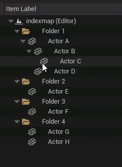

# Keep Visible — Design

**Latch v2.0.3 · User guide**

## Pin a row, not an Actor's render visibility

An eligible Actor or Folder has a reserved pin slot between the native icon and the text label. Hover the empty slot to reveal a **grey** pin; click to enable a **white** pin that remains visible. Click again to clear it.

Keep Visible helps a row remain accessible when its ancestor is collapsed. Latch can expose only the required path and show **yellow** ancestors. It does **not** unhide an Actor in the viewport or affect Hidden in Game.

*An enabled Keep Visible pin preserves a route to the chosen descendant while unrelated Outliner branches remain collapsed.*

## Why it follows an item

Pins are attached to the Actor or Folder's identity, not a specific screen position. Renaming, reparenting, attachment changes and moving between folders should preserve its pin where stable identity is available. A newly duplicated Actor starts without inherited pin state.

## When nothing visibly changes

An item at the Outliner root can be pinned, but no collapsed ancestor exists to reveal. A selected descendant may appear via Mixed View even without a white pin; selection alone does not silently add a pin.

---

[Read Technical](TECHNICAL.md) for C++ ownership and engine integration.
