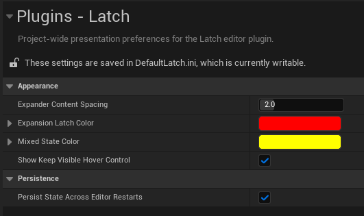

# Project Settings — Design

**Latch v2.0.3 · User guide**

## Find the settings

Go to **Edit → Project Settings → Plugins → Latch**. These settings affect how Latch appears and whether your workspace arrangement survives separate Unreal Editor sessions.

*Latch's Project Settings control expander spacing, semantic indicator colors, pin hover behavior and persistence.*

## Appearance options

| Setting | Default | Effect |
| --- | --- | --- |
| Expander Content Spacing | 2 | Space between the expander and Actor/Folder content; valid range 0–10 Slate units |
| Expansion Latch Color | Red | Color for latched-open and latched-closed triangles |
| Mixed State Color | Yellow | Color for logically collapsed rows exposing required descendants |
| Show Keep Visible Hover Control | On | Whether hovering the reserved inactive pin slot displays the grey pin |

An **active white pin remains visible** even when the inactive hover control is disabled.

## Persistence options

**Persist State Across Editor Restarts** is on by default. Switch it off if you want Latch state to remain only in the current editor session. **Clear Saved Latch State** removes the stored editor state after confirmation without changing your level.

## Example

Reduce Expander Content Spacing if you prefer labels closer to native triangle positions. If your Outliner is very dense, disable the grey pin-on-hover cue while still retaining enabled white pins.

These are per-project plugin/editor preferences, not properties you set on individual Actors.

---

[Read Technical](TECHNICAL.md) for exact editor implementation.
