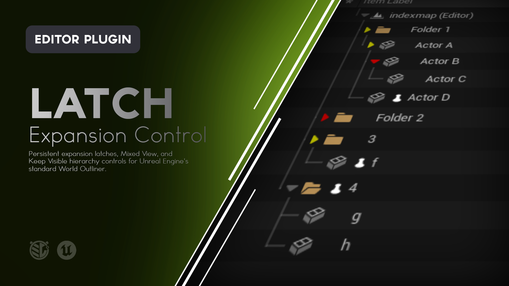

# Latch Documentation

**Latch v2.0.3 · Unreal Engine 5.8.x · Win64 · Editor-only**

Latch controls how Unreal Engine's **World Outliner hierarchy stays expanded, collapsed and selectively visible**. Keep finished areas closed, active work areas open and important descendants accessible without changing your level.

*Latch adds persistent expansion latches, selective Mixed View paths and Keep Visible pins to Unreal's existing World Outliner.*

## What can I accomplish with Latch?

**Preserve open and closed branches.** Alt-click an eligible Actor or Folder expansion triangle to latch its current expansion state. Red indicates that the row is latched.

**Keep descendants reachable.** Yellow Mixed View reveals only the ancestor path required for a selected, pinned or latched-open descendant. Unrelated siblings stay hidden.

**Pin important rows.** A white Keep Visible pin preserves an Actor or Folder's accessibility through collapsed ancestors; it does not change visibility in the game viewport.

**Use familiar editor gestures.** Shift-click recursively expands or collapses unlocked branches; context menus, multi-selection and viewport commands cover additional workflows.

**Keep the arrangement across sessions.** Expansion, pin and suspended state can be saved to per-project editor configuration without dirtying the map.

## Get started in three steps

1. [Install Latch](01-getting-started/install/DESIGN.md) in a supported Unreal Editor project.
2. [Try it in a test hierarchy](01-getting-started/first-use/DESIGN.md), beginning with a parent that has real children.
3. Learn [Expansion Latches](02-hierarchy-controls/expansion/DESIGN.md), [Mixed View](02-hierarchy-controls/mixed-view/DESIGN.md) and [Keep Visible](02-hierarchy-controls/keep-visible/DESIGN.md).

## Design and Technical

The **Design** pages are practical guides: what to click, what happens, and why. The **Technical** pages explain Slate integration, hierarchy reconciliation, Actor/Folder identity and persistence. Every topic has a corresponding pair.

## Explore the manual

| Category | Topics | Description |
| --- | ---: | --- |
| [01. Getting Started](01-getting-started/README.md) | 3 | Start using Latch |
| [02. Hierarchy Controls](02-hierarchy-controls/README.md) | 5 | Core controls |
| [03. Interactions and Workflows](03-interactions-and-workflows/README.md) | 4 | How you work with Latch |
| [04. Settings and Persistence](04-settings-and-persistence/README.md) | 4 | Saved editor layout |
| [05. Implementation and Support](05-implementation-and-support/README.md) | 4 | Architecture and help |

## Important limits

Latch changes **Outliner presentation only**. It does not change Actor visibility, location, folder membership, attachments or gameplay. Latching expansion requires a row with children; Keep Visible can apply to leaves. Search and Suspend Latch temporarily return presentation control to native Unreal behavior.

## Roadmap and support

[Roadmap](ROADMAP.md) · [Documentation Audit](DOCUMENTATION_AUDIT.md) · [Verification Matrix](VERIFICATION_MATRIX.md) · [Issues](https://github.com/mippi-the-dork/Latch/issues)

*The current descriptor identifies v2.0.3; the README has one older v1.0.18 compatibility-table entry that should be corrected separately. Source review does not substitute for live editor testing.*
